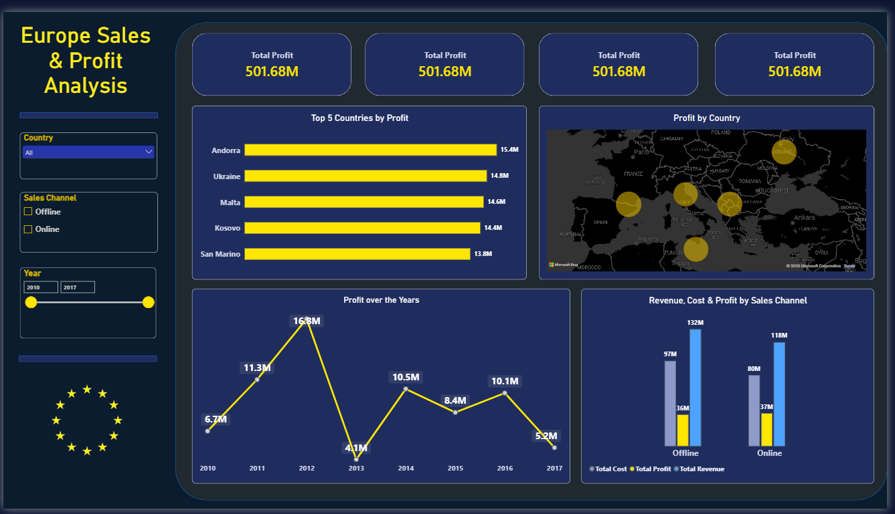

# Europe Sales & Profit Analysis | Power BI Dashboard

An interactive one-page Power BI dashboard analyzing sales, cost, and profit across European countries, product categories, and sales channels.



## Project Overview

The goal of this project was to turn a raw sales dataset into a clear, decision-ready dashboard that answers:

- Which countries generate the most profit?
- How has profit changed over time?
- How do Online and Offline channels compare?
- How do revenue, cost, and profit relate to each other?

## Dataset

| Field | Description |
|---|---|
| Region / Country | Geographic location of the sale |
| Item Type | Product category (Beverages, Cereal, Meat, etc.) |
| Sales Channel | Online or Offline |
| Order Priority | C (Critical), H (High), M (Medium), L (Low) |
| Order Date / Ship Date | Dates the order was placed and shipped |
| Units Sold | Quantity sold |
| Unit Price / Unit Cost | Selling price and cost per unit |
| Total Revenue | Units Sold x Unit Price |
| Total Cost | Units Sold x Unit Cost |
| Total Profit | Total Revenue - Total Cost |

## Tools Used

- **Power BI Desktop** (data modeling, DAX, visuals)
- **DAX** (custom measures)
- **Excel / CSV** (source data)

## Dashboard Features

- **KPI cards:** Total Profit, Total Revenue, Total Units Sold, Top Country by Profit
- **Top 5 Countries by Profit:** ranked bar chart
- **Profit by Country:** map with bubble size by profit
- **Profit over the Years:** trend line, 2010-2017
- **Revenue, Cost & Profit by Sales Channel:** clustered column chart
- **Slicers:** Country, Sales Channel, and Year, all cross-filtering every visual

## DAX Measures

```DAX
Top Country by Profit =
VAR CountryProfit =
    ADDCOLUMNS(
        VALUES('Europe Sales Records'[Country]),
        "@Profit", CALCULATE(SUM('Europe Sales Records'[Total Profit]))
    )
RETURN
    MAXX(
        TOPN(1, CountryProfit, [@Profit], DESC),
        'Europe Sales Records'[Country]
    )
```

```DAX
Profit Margin % =
DIVIDE(
    SUM('Europe Sales Records'[Total Profit]),
    SUM('Europe Sales Records'[Total Revenue])
)
```

## Key Insights

1. **Strong overall profitability:** 1.70bn in revenue and 501.68M in profit across 7M units sold, a margin of roughly 30%.
2. **Balanced market performance:** Andorra leads with 15.4M profit, followed by Ukraine (14.8M), Malta (14.6M), Kosovo (14.4M), and San Marino (13.8M). The gap between 1st and 5th is about 10%, so profit is not concentrated in one market.
3. **Volatile profit trend:** *(verify against your final chart before publishing)* Profit peaked in 2012 and dropped sharply in 2013, then kept fluctuating without a steady growth trend.
4. **Channels are close:** Online and Offline contribute similar profit, so neither channel clearly outperforms the other.
5. **Margins vary by product:** Revenue does not equal profit. Some categories keep a much larger share of each sale than others (for example, Cosmetics vs. Meat).

## Data Cleaning Notes

- Some rows have a **Ship Date earlier than the Order Date**, which is a data quality issue. These were flagged during review.
- Date fields were converted to proper date types to support the Year slicer and trend analysis.

## Design Decisions

- Dark navy theme with **yellow reserved for profit**, so the key metric always stands out.
- Left sidebar for filters, so the main panel is only for data.
- One page on purpose: the dataset is a single fact table, so extra pages would add clutter, not insight.

## Next Steps

- Investigate what drove the 2013 profit decline.
- Add a **Profit Margin % by Item Type** visual to identify the highest-margin categories.
- Add a shipping delay analysis (Ship Date - Order Date).

## Files

- `Europe_Sales_Dashboard.pbix`: Power BI report
- `dashboard.png`: dashboard screenshot
- `Europe Sales Records.csv`: source data

## Author

**Shahim Al-Rhahleh** | Data Analyst
Skills: SQL, Python, Power BI, Excel
[LinkedIn](#) | [GitHub](#)
